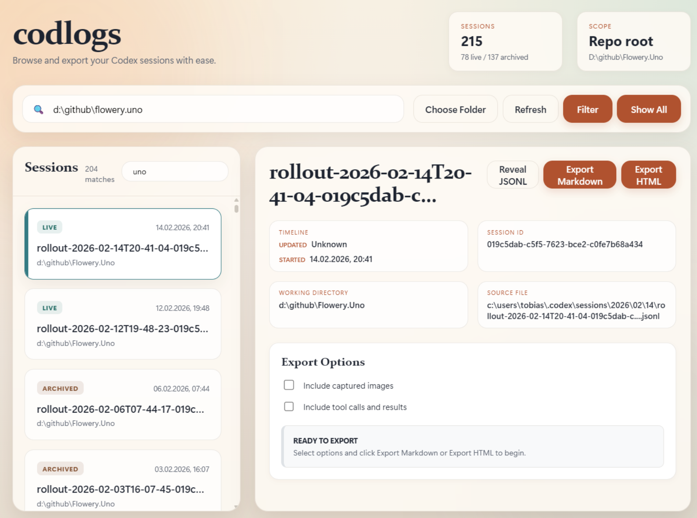
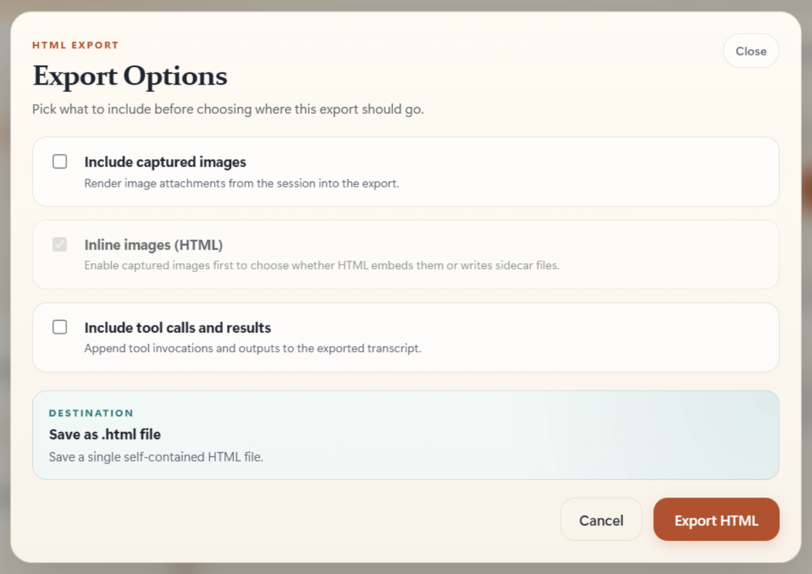

<p align="center">
  
</p>

<p align="center">
  
  
  
  
  
</p>

# codlogs

`codlogs` is a read-only Codex session tool with two entry points:

- a global CLI for finding sessions and exporting one `.jsonl` session to Markdown, HTML or an OpenCode 2 session file
- an Electrobun desktop browser for scanning sessions, filtering by folder, and exporting the selected session to `.md`, `.html` or `.opencode.json`

Planning and investigation artifacts for this repo live under `devlog/YYYY-MM-DD/`.

This repository uses Bun as its development package manager and commits `bun.lock`.
If you are working in this repo, use `bun install` instead of `npm install` or `pnpm install`.
New dependency versions must be at least seven days old. `bunfig.toml` applies this delay to direct and transitive package resolution.

<p align="center">
  
</p>

<p align="center">
  
</p>

The desktop app can summarize token usage for the currently filtered sessions, including cached input, uncached input, output, reasoning output, and the number of token-count rows scanned. It can also summarize errored tool calls across the filtered set by matching tool outputs back to tool inputs, grouping distinct failure patterns, and saving large results as Markdown.

## CLI

Install it globally from this folder:

```powershell
npm install -g d:\github\codlogs
```

Use either `codlogs` or `codlogs-sessions`:

```powershell
codlogs
codlogs --json
codlogs --help
codlogs d:\github\myDUDreamTool
codlogs /mnt/d/github/myDUDreamTool
codlogs --md C:\Users\tobitege\.codex\sessions\2026\03\06\session.jsonl
codlogs --html C:\Users\tobitege\.codex\sessions\2026\03\06\session.jsonl
codlogs --md C:\Users\tobitege\.codex\sessions\2026\03\06\session.jsonl --include-images --include-tool-results
codlogs --opencode C:\Users\tobitege\.codex\sessions\2026\03\06\session.jsonl --include-images --include-tool-results
```

Notes:

- the folder argument is optional; if omitted, the current working directory is used
- if the folder is inside a git repo, the CLI matches sessions for the repo root by default
- use `--json` to print machine-readable session results
- use `-h` or `--help` to show the built-in CLI help text
- use `--cwd-only` to match only the folder tree you pass in
- use `--codex-home PATH` if your Codex data lives somewhere other than `%CODEX_HOME%` or `~/.codex`
- use `--include-images` with `--md` or `--html` to write embedded images into a sibling `.assets` folder
- use `--html` to export a session as an HTML transcript; with `--include-images`, codlogs writes a sibling `.assets` folder
- use `--include-tool-results` with `--md`, `--html` or `--opencode` to include tool calls and tool outputs in the export
- use `--opencode` to write a `.opencode.json` session file for OpenCode 2; see [OpenCode Session Export](#opencode-session-export)
- Windows drive paths, WSL `/mnt/<drive>/...` paths, and WSL UNC paths are treated as aliases of the same repo

## Desktop App

The desktop browser uses [Electrobun](https://electrobun.dev/).

Prerequisites:

- Bun `>=1.3.12`
- Windows 11+ with WebView2 available for the embedded webview runtime

Run it locally:

```powershell
bun install
bun run start
```

For live UI reload while editing:

```powershell
bun run dev:hmr
```

Other useful commands:

```powershell
bun run build:web
bun run build
```

Notes:

- `bun run start` is the easiest local launch path because it builds the web assets first
- the first desktop command downloads the Electrobun 2 toolchain and prepares `.hutch/devkit`; the app uses Bun as its main-process runtime
- `bun run prepare:desktop` prepares the SDK for editor support without building or starting the app
- `bun run typecheck` prepares the SDK and checks TypeScript; `bun run test` runs the shared regression suite
- the app defaults to the current folder tree on launch

Current desktop app highlights:

- scans live and archived Codex sessions from `~/.codex` or `%CODEX_HOME%`
- filters by current folder tree or repo root and can include cross-session writes
- exports the selected session to Markdown, HTML or an OpenCode 2 session file
- summarizes token usage for one selected session or all currently filtered sessions
- summarizes distinct errored tool calls across filtered sessions
- shows a collapsible environment status section for:
  - Codex home read/write access
  - `git` availability
  - `rg` availability
- lets you rename a session title directly from the session list
  - titles are written back to Codex `session_index.jsonl`
  - Codex uses that file as the visible thread-name source of truth
- each session card has a chat replay button that opens a full-window session browser dialog
  - read-only transcript view; nothing is executed
  - searchable with `Ctrl+F`, copyable per entry or with `Copy All`
  - can hide or show tool calls and tool outputs
  - skips `developer` messages and the first bootstrap user message to match the export view
  - truncates very large transcripts at a fixed entry limit and reports skipped oversized rows

## Large Session Handling

codlogs is built to stay usable even when a Codex session file becomes very large.

Current behavior:

- probes session file size without loading the whole file into memory
- uses bounded JSONL scanning for browsing and detail inspection
- skips automatic deep analysis for very large sessions to keep the UI responsive
- surfaces explicit analysis states in the desktop app such as `Full`, `Partial`, and `Skipped`
- offers `Analyze Anyway` for a bounded manual scan when automatic analysis is skipped
- treats oversized JSONL rows as partial-analysis conditions instead of crashing normal inspection
- streams Markdown and HTML export so large session files do not require whole-file reads during export
- publishes the output only after the complete transcript has been written; cancellation and write errors preserve an existing export
- gives each export its own image subfolder under `<output-name>.assets`, so other exports retain their original images
- retains uniquely named `.partial` files and image subfolders from interrupted exports for recovery; codlogs does not delete previous exports or sidecars

Practical effect:

- browsing large session folders stays responsive
- selecting a very large session remains safe by default
- export still works for large sessions, but may take longer than normal
- sanitization is optional and separate from the normal large-session browsing/export path

## Session Sanitization

The desktop app includes a `Sanitize Session...` action for producing a derived, smaller JSONL from a large Codex session without modifying the source file.

Current sanitization behavior:

- rewrites the source JSONL line by line and preserves original row order
- preserves opaque `response_item` compaction rows
- preserves rollout-level `type: "compacted"` rows in place
- strips image payloads from normal response rows, `event_msg` user messages, and compacted `replacement_history`
- can optionally use `Strip all blobs` to remove large tool payloads, encrypted reasoning blobs, token-count payloads, and bulky turn-context payloads
- never uses aggressive blob stripping inside `type: "compacted"` replacement history

Sanitize modal options:

- `Create new JSONL copy file`
  - writes `sanitized-session.jsonl` plus `sanitization-report.json` into a fresh temp folder under `%TEMP%\\codlogs\\sanitized-sessions\\...`
- `Strip all blobs`
  - shrinks the output further, but is more aggressive and therefore more compatibility-risky than image stripping alone
- `Re-add session to current day`
  - writes an additional canonical Codex session file into `.../.codex/sessions/YYYY/MM/DD/`
  - uses the default Codex rollout naming convention: `rollout-YYYY-MM-DDThh-mm-ss-<thread-id>.jsonl`
  - generates a fresh UUIDv7-style thread ID and writes that same ID into both the filename and `session_meta.id`
  - also appends the chosen chat name to Codex `session_index.jsonl` so the re-added session appears with a readable title

Title handling:

- the sanitize modal includes a `Chat name` field for `Re-add session to current day`
- session renaming and sanitize re-add use the same shared title sanitizer
- title input is normalized before writing:
  - trims and collapses whitespace
  - strips control characters and bidi-control markers
  - caps the stored title length

Compatibility notes:

- the source session is only read, never modified
- sanitized output is derived, not byte-for-byte identical to the original
- preserving both opaque compaction rows and `type: "compacted"` rows is intentional because Codex resume compatibility depends on them
- after a successful sanitize run, the desktop UI refreshes the session list automatically

## OpenCode Session Export

codlogs can write a Codex session as a session file for [OpenCode](https://opencode.ai/) 2, so the conversation can be read and continued there. Use `Export OpenCode` in the desktop app or `--opencode` on the command line:

```powershell
codlogs --opencode C:\Users\tobitege\.codex\sessions\2026\03\06\session.jsonl --include-images --include-tool-results
```

The file is written next to the session as `<session>.opencode.json`, or into the folder chosen in the desktop app.

Import the file in OpenCode in one of two ways:

- In the OpenCode desktop app: in the sidebar under `Projects`, open the `⋯` menu (`More options`) of the project the session should belong to, choose `Import session` and pick the file.
- On the command line: `opencode session import <file> --directory <project folder>`. OpenCode attaches the session to the project of `--directory`, or of the current folder without it. With only the desktop app installed, `opencode` is not on the PATH; on Windows its command line program is `%LOCALAPPDATA%\Programs\ai.opencode.desktop\resources\opencode-cli.exe`.

What the file contains:

- each prompt as a user message; with `--include-images`, its images are embedded as attachments
- each model response as an assistant message with its reasoning summaries and text, under the Codex model name and provider
- with `--include-tool-results`, each tool call with its input and output; a call without a recorded output is marked as failed
- an idle marker where Codex ended a turn, with the outcome `succeeded`, `failed` or `interrupted`
- the Codex thread name as the session title (the first prompt if the thread has no name), the start time and the token totals
- a compaction summary where an older Codex version stored one as text

Notes:

- include tool calls and results when the session is meant to be continued; without them OpenCode sees only the prompts and answers
- instructions, developer messages and the bootstrap context are left out, as in the Markdown and HTML exports
- only images embedded in the session are exported; image links are skipped
- the session and message identifiers are derived from the Codex session, so importing the same session again reports `Session already exists`; delete the imported session in OpenCode first to import a newer export
- Codex tool names such as `exec` or `apply_patch` are kept as they are; OpenCode shows these calls but has no tools of the same name
- OpenCode reads the whole file into memory during the import, so a session with many images needs correspondingly more memory there
- the format follows `opencode session export` of OpenCode 2.3 and was tested against `opencode session import` of that version

## Changelog

### [1.5.0] - 2026-11-17

- Export a session as an OpenCode 2 session file for `opencode session import`: `Export OpenCode` in the desktop app and `--opencode FILE` in the CLI. The existing options for images and for tool calls and results apply.

### [1.4.2] - 2026-11-09

- Updated Vite to 8.3.4, which fixes the open Vite and launch-editor security advisories.
- Updated Electrobun to 2.0.2, @vitejs/plugin-react to 6.1.2, concurrently to 10.0.6 and @types/bun to 1.4.3.

### [1.4.1] - 2026-10-06

- Updated React and React DOM to 19.3.0, Vite to 8.3.1, and the Bun and React type packages.
- Updated transitive dependencies within their allowed ranges. All updated npm package versions are at least seven days old.
- Updated Bun in the package metadata and workflows to 1.4.2. Updated Node 22 in the workflows to 22.23.3.
- Updated the checkout and setup-node GitHub Actions to v7.

### [1.4.0] - 2026-09-14

- Preserve existing exports and images when an export is cancelled or fails. Publish completed transcripts atomically and isolate image files per export.
- Escape HTML headers and generated Markdown metadata. Validate image URLs and base64 data, encode asset links, and fix image labels and custom output filenames.
- Preserve message indentation, line breaks, and image order. Keep later user messages that quote bootstrap instructions and omit images from excluded bootstrap messages.
- Accept UTF-8 BOM metadata and skip malformed or non-object JSON records. Handle large JSONL rows and tool output without repeated buffer copies or code-fence argument overflow.
- Use one streaming export pipeline, remove unused whole-file exporters, and add regression tests for both formats and the Node CLI.
- Update all ten direct dependencies and the lockfile, subject to the seven-day release delay. Migrate the desktop build to Electrobun 2.0.1 and TypeScript 7.0.2, with React 19.2.8 and Vite 8.2.2.
